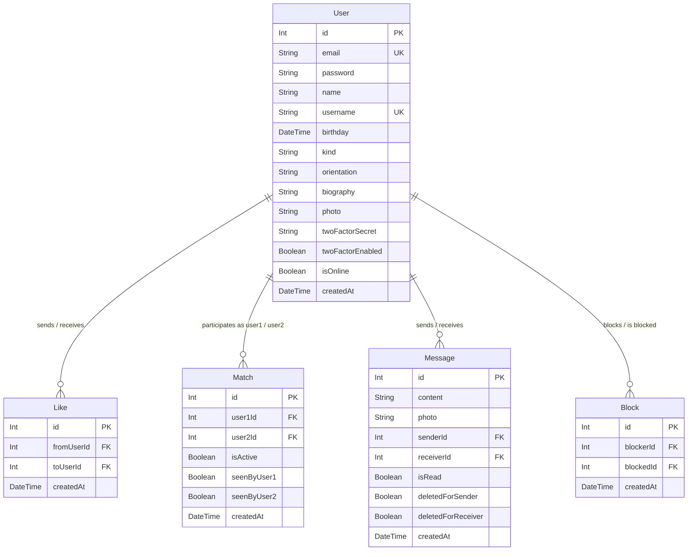

*This project has been created as part of the 42 curriculum by rmetge, bemma, cipelat, desambou.*

# Chi-Fou-Mi (Transendanse) — ft_transcendence


---

## Table of Contents
1. [Description](#description)
2. [Team Information](#team-information)
3. [Project Management](#project-management)
4. [Technical Stack](#technical-stack)
5. [Modules & Point Calculation](#modules--point-calculation)
6. [Bonus Part (Chapter VII)](#bonus-part-chapter-vii)
7. [Features List](#features-list)
8. [Database Schema](#database-schema)
9. [Individual Contributions](#individual-contributions)
10. [Instructions & Setup](#instructions--setup)
11. [Resources & AI Usage](#resources--ai-usage)
12. [License & Compliance](#license--compliance)

---

## Description

**Chi-Fou-Mi** (code-named *Transendanse*) is a modern, real-time social discovery and matchmaking web platform designed to connect people in an engaging, lively environment. Built as the final milestone of the 42 Common Core curriculum (*ft_transcendence*), the application combines relationship matching with real-time bidirectional instant messaging, granular privacy controls, two-factor authentication, enterprise-grade secret management, and a complete DevSecOps monitoring and recovery pipeline.

### Key Highlights
- **Smart Dating & Discovery**: Browse user cards, express interest via mutual likes, discard or block profiles, and trigger instant matches.
- **Real-Time Messaging**: Instant direct chat powered by WebSockets (Socket.IO) with live typing updates, unread counters, and online status indicators.
- **Enhanced Security**: User registration with Bcrypt hashing, JWT authentication guards, optional TOTP Two-Factor Authentication (Google Authenticator / QR code), OWASP ModSecurity Web Application Firewall (CRS v4), and HashiCorp Vault secrets management.
- **High Availability & Observability**: Complete Prometheus and Grafana monitoring stack with customized metrics, Alertmanager email notifications, a dedicated status page, and automated AES-256 encrypted database backups with a tested disaster recovery procedure.

---

## Team Information

| Member | 42 Login | Assigned Roles | Responsibilities |
|---|---|---|---|
| **Delphine Sambouni** | `desambou` | **Technical Lead / Architect**, Developer | High-level system architecture, Nginx TLS & ModSecurity WAF, HashiCorp Vault mTLS & secret distribution, Prometheus/Grafana monitoring, Alertmanager, automated backups and disaster recovery. |
| **Romane Metge** | `rmetge` | **Project Manager (PM) / Scrum Master**, Developer | Sprint coordination, task tracking, frontend architecture, user profile lifecycle (creation, modification), avatar picker & cropper integration, 2FA interface flow, design system implementation. |
| **Cindy Pelat** | `cipelat` | **Project Manager (PM) / Scrum Master**, Developer | Team synchronization, backend authentication architecture, JWT guards & strategy, input validation & DTO audits, WebSocket gateway lifecycle & error handling, database test seed scripts. |
| **Emma Bouichou** | `bemma` | **Product Owner (PO)**, Developer | Product vision, feature backlog prioritization, match algorithm & discovery logic, real-time conversation user experience, contact lists, activity tracking, match deletion and block management. |

---

## Project Management

### Organization & Workflow
- **Sprint Cycles & Syncs**: The team maintained regular progress meetings every week to two weeks (both on-site at 42 and via remote video calls) to review delivered features, evaluate blockers, and adjust upcoming deliverables.
- **Task Distribution**: Divided cleanly across domains: DevSecOps & Infrastructure, Backend Core & Security, Dating Engine & Messaging, and Frontend UX & State Management.
- **Code Reviews & Quality Assurance**: Pull requests were systematically merged into the `dev` branch with cross-member testing before deployment to staging/production branches.

### Tools Used
- **GitHub**: Source code hosting, branching strategy (`dev`, feature branches, and release copies), Pull Request reviews, and issue management.
- **Discord**: Primary communication channel featuring dedicated voice meeting rooms and topic channels (e.g., `#devops`, `#backend`, `#frontend`, `#bugs`).
- **Canva**: Wireframing, interface ergonomics, color palette conception, and UX flow prototyping.

---

## Technical Stack

### Frontend
- **Framework**: [Next.js](https://nextjs.org/) (v15 / React 19) — App Router architecture, responsive client-side routing, and optimized builds.
- **Styling**: [Tailwind CSS](https://tailwindcss.com/) — Curated responsive styles, gradients, glassmorphism, and micro-animations.
- **State & Data Fetching**: 
  - [@tanstack/react-query](https://tanstack.com/query) — Asynchronous state caching, automatic query invalidation, and background synchronization.
  - [Zustand](https://zustand-demo.pmnd.rs/) — Lightweight client-side global store for notifications and unread message counters.
- **Network & Realtime**: [Axios](https://axios-http.com/) (configured with Bearer JWT interceptors and 401 handling), [Socket.io-client](https://socket.io/) (bidirectional events).
- **Forms & Icons**: `react-hook-form`, `lucide-react`, `react-easy-crop`.

### Backend
- **Framework**: [NestJS](https://nestjs.com/) (v11) — Modular, scalable TypeScript server framework running Node.js.
- **Authentication & Security**: `@nestjs/passport`, `passport-jwt`, `bcrypt` (salted password hashing), `class-validator`, `class-transformer` (strict payload whitelisting).
- **Two-Factor Authentication**: `otplib` (RFC 6238 TOTP engine) and `qrcode` (Base64 QR code generator).
- **WebSockets**: `@nestjs/websockets`, `@nestjs/platform-socket.io`, `socket.io` — Gateway managing private user rooms (`user_<id>`) and real-time events.

### Database & ORM
- **Database Engine**: [PostgreSQL](https://www.postgresql.org/) 15 — Relational data model with ACID compliance and foreign key integrity.
- **ORM**: [Prisma](https://www.prisma.io/) 6 — Schema-driven migrations, strongly typed database client, and query relation optimizations.

### Security & Infrastructure (DevSecOps)
- **Reverse Proxy & WAF**: [Nginx](https://nginx.org/) Alpine running [OWASP ModSecurity Core Rule Set (CRS v4)](https://coreruleset.org/) with tailored rules to inspect HTTP payloads, block attacks, and enforce TLS 1.2/1.3.
- **Secrets Management**: [HashiCorp Vault](https://www.hashicorp.com/products/vault) 1.13 — Initialized with Shamir key shares, serving database credentials and JWT signing secrets dynamically over TLS via scoped policies and read-only secret projections.
- **Containerization**: [Docker](https://www.docker.com/) & Docker Compose — Multi-container orchestrated network with healthchecks, unprivileged user permissions, and persistent volumes.

### Monitoring & Operations
- **Prometheus** (v2.54.1): Metrics scraping every 15s across 9 monitored targets (Node, Postgres, Vault, Blackbox probes, and Backups).
- **Grafana** (v11.2.2): Operational dashboard visualizing service latency, container health, HTTP probes, and database connections.
- **Alertmanager** (v0.28.1): Automated email notification delivery using Google SMTP for critical operational failures.
- **Status Page**: Lightweight Node.js micro-service exposing `/api/health` and a live status interface.
- **Automated Backup & Disaster Recovery**: Scheduled AES-256-CBC encrypted dumps every 10 minutes with strict permissions and an audited restoration runbook ([RESTORE.md](RESTORE.md)).

---

## Modules & Point Calculation

The project implements **15 full modules** across 5 categories, totaling **21 points**. This fulfills the **14 mandatory points** requirement and claims the **maximum 5 bonus points** allowed by the 42 subject (with 2 additional safety points):

```
┌─────────────────────────────────────────────────────────────┬─────────┬────────┐
│ Module Category & Specification                             │ Type    │ Points │
├─────────────────────────────────────────────────────────────┼─────────┼────────┤
│ PART A: MANDATORY MODULES (Minimum 14 Points)               │         │        │
├─────────────────────────────────────────────────────────────┼─────────┼────────┤
│ 1.  Web: Framework for both frontend and backend            │ Major   │ 2 pts  │
│ 2.  Web: Real-time features using WebSockets                │ Major   │ 2 pts  │
│ 3.  Web: Allow users to interact with other users           │ Major   │ 2 pts  │
│ 4.  Web: Use an ORM for the database (Prisma)               │ Minor   │ 1 pt   │
│ 5.  User Management: Standard user management & auth        │ Major   │ 2 pts  │
│ 6.  Cybersecurity: WAF ModSecurity + HashiCorp Vault        │ Major   │ 2 pts  │
│ 7.  Devops: Monitoring system (Prometheus + Grafana)        │ Major   │ 2 pts  │
│ 8.  Devops: Status Page & Automated Backups / Disaster Rec. │ Minor   │ 1 pt   │
├─────────────────────────────────────────────────────────────┼─────────┼────────┤
│ SUB-TOTAL MANDATORY POINTS                                  │         │ 14 pts │
├─────────────────────────────────────────────────────────────┼─────────┼────────┤
│ PART B: BONUS MODULES (Chapter VII — Maximum +5 Points)     │         │        │
├─────────────────────────────────────────────────────────────┼─────────┼────────┤
│ 9.  User Management: Complete 2FA system (TOTP / QR code)   │ Minor   │ +1 pt  │
│ 10. Gaming & UX: Advanced chat features (Block, history)    │ Minor   │ +1 pt  │
│ 11. Web: Custom-made design system (14+ reusable components)│ Minor   │ +1 pt  │
│ 12. Web: File upload and management system (Avatars)        │ Minor   │ +1 pt  │
│ 13. User Management: User activity analytics dashboard       │ Minor   │ +1 pt  │
├─────────────────────────────────────────────────────────────┼─────────┼────────┤
│ SUB-TOTAL CLAIMED BONUS POINTS (Max allowed by 42: 5 pts)   │         │ +5 pts │
├─────────────────────────────────────────────────────────────┼─────────┼────────┤
│ RESERVE BONUS MODULES (Safety Margin)                       │         │        │
├─────────────────────────────────────────────────────────────┼─────────┼────────┤
│ 14. Web: Complete notification system (Matchs, messages)    │ Minor   │ (+1 pt)│
│ 15. Web: Server-Side Rendering (SSR) & SEO optimizations     │ Minor   │ (+1 pt)│
├─────────────────────────────────────────────────────────────┼─────────┼────────┤
│ TOTAL VALIDATED POINTS ACROSS PLATFORM                      │         │ 21 pts │
└─────────────────────────────────────────────────────────────┴─────────┴────────┘
```

---

### Module Descriptions & Implementation Details

#### 1. Web: Major — Framework for Frontend and Backend (2 pts)
- **Implementation**: Utilizes **Next.js 15** on the frontend and **NestJS 11** on the backend.
- **Justification**: NestJS provides an enterprise-grade modular architecture (controllers, services, guards, dependency injection), while Next.js provides modern React 19 capabilities with optimized client-side routing.
- **Contributors**: `cipelat`, `rmetge`, `bemma`.

#### 2. Web: Major — Real-time features using WebSockets (2 pts)
- **Implementation**: Realized through Socket.IO with a custom NestJS `MessageGateway` and Next.js `SocketProvider`.
- **Features**: Real-time direct message delivery, dynamic unread badge counts, instant new match alerts (`newMatch`), read receipt broadcasts (`messagesRead`), and live online/offline presence tracking (`isOnline`).
- **Contributors**: `cipelat`, `bemma`, `rmetge`.

#### 3. Web: Major — Allow users to interact with other users (2 pts)
- **Implementation**: Comprehensive social interaction layer including private messaging, profile inspection, mutual matching (likes), match deletion, and user blocking.
- **Justification**: Matches allow users to connect; once matched, users can initiate private discussions and inspect counterpart profiles with live status.
- **Contributors**: `bemma`, `cipelat`.

#### 4. Web: Minor — Use an ORM for the database (1 pt)
- **Implementation**: **Prisma ORM 6** connected to PostgreSQL 15.
- **Justification**: Provides type-safe queries, migration control, schema definitions, and relation integrity across models without raw SQL vulnerabilities.
- **Contributors**: `desambou`, `cipelat`.

#### 5. Web: Minor — Custom-made Design System (1 pt)
- **Implementation**: Clean, coherent UI kit built with Tailwind CSS, custom color palettes (rose, orange, deep blue), Google Geist typography, and Lucide icons.
- **Components Implemented (14 reusable components)**:
  1. `ProfileCard` — Card displaying user profile data and avatar.
  2. `AvatarPicker` — Avatar upload and menu trigger button.
  3. `AvatarCropperModal` — Interactive crop, zoom, and rotate modal.
  4. `Menu` — Sliding settings dropdown with 2FA toggle and logout.
  5. `EditCard` — Profile section editor wrapper.
  6. `MatchProfile` — Match detail previewer.
  7. `Contact` — Contact list item with online presence dot and unread badge.
  8. `Discution` — Chat container with speech bubbles and delete action.
  9. `Activity` — Activity feed row with customized status emojis and badges.
  10. `Bottom` — Full-page background container with vibrant gradients.
  11. `Footer` — Fixed layout footer linking to legal privacy pages.
  12. `Navigation` — Bottom navigation bar with animated badge counters.
  13. `IfIsLoading` — Cohesive loading state indicator.
  14. `IfIsError` — Cohesive error banner with retry triggers.
- **Contributors**: `rmetge`, `bemma`.

#### 6. Web: Minor — File Upload and Management System (1 pt)
- **Implementation**: 
  - Supports image uploads (JPEG, PNG, WebP) with client-side mime-type and size checks.
  - Interactive crop and zoom preview powered by `react-easy-crop`.
  - Secure Base64 encoding with calibrated Express body limits (10 MB).
  - Storage in PostgreSQL and immediate avatar deletion capability (`photo: null`).
- **Contributors**: `rmetge`.

#### 7. Web: Minor — Complete Notification System (1 pt)
- **Implementation**: Real-time visual and socket-driven alerts notifying users across actions:
  - New mutual match alert (`newMatch` event).
  - Unread incoming message counter badge with live updates on the navigation bar.
  - Read receipts notifications (`messagesRead`).
  - Action confirmations for profile edits, match deletion, and user blocking.
- **Contributors**: `bemma`, `rmetge`, `cipelat`.

#### 8. Web: Minor — Server-Side Rendering (SSR) & SEO (1 pt)
- **Implementation**: Next.js 15 App Router provides Server-Side Rendering, semantic HTML5 structure, descriptive page titles, and meta tags for high performance and fast first-contentful paint.
- **Contributors**: `rmetge`.

#### 9. User Management: Major — Standard User Management and Authentication (2 pts)
- **Implementation**: Secure registration, email/password login, password hashing via `bcrypt` (10 salt rounds), JWT Bearer authentication with Passport strategies, complete profile edition (bio, gender, orientation, birthday), Base64 avatar upload with image cropping (`react-easy-crop`), and real-time online status.
- **Contributors**: `rmetge`, `cipelat`.

#### 10. User Management: Minor — Complete 2FA (Two-Factor Authentication) System (1 pt)
- **Implementation**: RFC 6238 TOTP algorithm using `otplib` and `qrcode`. Users can enable 2FA from their profile settings, scan the QR code in Google Authenticator or any TOTP app, verify with a 6-digit token, and are prompted for their 2FA code upon subsequent logins before receiving their JWT.
- **Contributors**: `rmetge`, `cipelat`.

#### 11. User Management: Minor — User Activity Analytics Dashboard (1 pt)
- **Implementation**: Dedicated `/activity` page tracking real-time user engagement. Displays a live chronological timeline of mutual matches, sent likes, received likes, and interaction timestamps powered by `useActivity()`.
- **Contributors**: `bemma`.

#### 12. Cybersecurity: Major — WAF/ModSecurity + HashiCorp Vault (2 pts)
- **Implementation**:
  - **WAF**: Nginx compiled with OWASP ModSecurity Core Rule Set (CRS v4) with 850+ inspection rules blocking SQL injections, XSS, and malicious payloads.
  - **Vault**: HashiCorp Vault 1.13 running with TLS inside an isolated network. An automated initialization script (`vault-init.sh`) handles unsealing via Shamir keys, provisions secrets into Vault's KV v2 engine, creates scoped policies (`backend-policy`), and distributes read-only secrets to consuming containers.
- **Contributors**: `desambou`.

#### 13. Gaming & UX: Minor — Advanced Chat Features (1 pt)
- **Implementation**: Enhances the real-time chat with essential safety and convenience features:
  - User blocking (`Block` table) preventing blocked accounts from messaging or appearing in discovery.
  - Access to full user profiles directly by clicking on the conversation header.
  - Chat history persistence stored safely in PostgreSQL.
  - Live read receipts (`isRead`) and unread badges.
  - Individual message deletion and complete conversation deletion.
- **Contributors**: `bemma`, `cipelat`.

#### 14. Devops: Major — Monitoring System with Prometheus and Grafana (2 pts)
- **Implementation**: Prometheus 2.54 scrapes 9 distinct targets across the platform (Node Exporter, Postgres Exporter, Vault internal metrics, Blackbox HTTP/HTTPS probes, and Backup monitor exporter). Grafana 11.2 displays metrics via a custom dashboard (`grafana/dashboards/overview.json`). Alertmanager triggers automated email alerts via Gmail SMTP when backups are stale or containers fail.
- **Contributors**: `desambou`.

#### 15. Devops: Minor — Health check, Status Page & Automated Backups / Disaster Recovery (1 pt)
- **Implementation**:
  - Independent status page micro-service running on port 3001 reporting live component health.
  - Automated PostgreSQL backup script (`backup.sh`) executing every 10 minutes, generating AES-256-CBC encrypted dumps with PBKDF2 key derivation and maintaining a rolling retention of 6 snapshots.
  - Tested disaster recovery plan documented step-by-step in [RESTORE.md](RESTORE.md).
- **Contributors**: `desambou`.

---

## Bonus Part (Chapter VII)

In accordance with **Chapter VII (Bonus part)** of the 42 subject:
> *"The bonus part will be considered only if all required modules have been implemented corresponding to the minimum of 14 mandatory points. Each additional module implemented beyond the required 14 points may be considered as a bonus [...]. You can have a maximum of 5 points."*

Our platform satisfies the baseline with **14 mandatory points** (Modules 1 to 8) and presents the following **extra modules claimed as Bonus** (capped at the maximum **+5 points** allowed, with 2 extra backup modules):

### Claimed Bonus Modules (Max +5 Points)

| Bonus Module | Scope | Value | Evaluation Criteria Verification |
|---|---|---|---|
| **Bonus 1: Complete 2FA System** | *User Management* | **+1 pt** | **Fully Functional**: Real RFC 6238 TOTP engine (`otplib`) with dynamic QR code generation (`qrcode`), secure secret storage in PostgreSQL, profile toggle with activation confirmation modal, and mandatory verification challenge during login before JWT delivery. Adds critical security value by shielding user accounts against compromised credentials. |
| **Bonus 2: Advanced Chat Features** | *Gaming & UX* | **+1 pt** | **Fully Functional**: Enhances direct messaging with user blocking (`Block` table), direct counterpart profile viewing from active conversation headers, PostgreSQL chat history persistence, instant message deletion (`/message/message/:id`), conversation purge, and real-time read receipt updates (`isRead`). Adds substantial UX and privacy value. |
| **Bonus 3: Custom Design System** | *Web* | **+1 pt** | **Fully Functional**: A custom UI library of **14 reusable components** (`ProfileCard`, `AvatarPicker`, `AvatarCropperModal`, `EditCard`, `MatchProfile`, `Contact`, `Discution`, `Activity`, `Menu`, `Bottom`, `Footer`, `Navigation`, `IfIsLoading`, `IfIsError`) designed with Tailwind CSS, Google Geist typography, and Lucide icons. Adds high architectural and visual value through code reusability. |
| **Bonus 4: File Upload & Management System** | *Web* | **+1 pt** | **Fully Functional**: Interactive avatar upload pipeline supporting multiple image formats (JPEG, PNG, WebP), client-side MIME/size validation, interactive zoom and crop preview via `react-easy-crop`, Base64 payload optimization (Express 10MB limit), secure database storage, and avatar deletion (`photo: null`). Adds vital personalization value. |
| **Bonus 5: User Activity Analytics Dashboard** | *User Management* | **+1 pt** | **Fully Functional**: Dedicated `/activity` dashboard tracking user engagement in real time. Displays chronological activity streams of mutual matches, sent likes, received likes, and timestamps, backed by `GET /match/activity` and dynamic React Query caching. Adds high engagement and feedback value. |

### Reserve Bonus Modules (Safety Margin)
- **Web: Minor — Complete Notification System (+1 pt)**: Real-time visual and socket-driven alerts (`newMatch` modal notifications, live unread counter badges on navigation, `messagesRead` event triggers).
- **Web: Minor — Server-Side Rendering (SSR) & SEO (+1 pt)**: Next.js 15 App Router server-side compilation, semantic layout elements, and optimized meta descriptions.

---

## Features List

| Feature | Description | Contributor(s) |
|---|---|---|
| **Account Registration & Login** | Email/password sign-up with strict validation, Bcrypt salt hashing, and JWT issuance. | `cipelat`, `rmetge` |
| **Two-Factor Authentication (2FA)** | TOTP QR code enrollment and mandatory code verification on login. | `rmetge`, `cipelat` |
| **Profile Creation & Edition** | Mandatory profile onboarding (bio, birthday, gender, orientation) and update form. | `rmetge` |
| **Avatar Cropping & Upload** | Interactive image crop modal exporting high-definition Base64 image strings. | `rmetge` |
| **Discovery & Matchmaking** | Swiping/browsing system, profile sorting, mutual likes validation, and match notifications. | `bemma` |
| **Direct Instant Messaging** | Real-time chat powered by WebSockets, message history, and message deletion. | `bemma`, `cipelat` |
| **Activity Timeline** | Chronological feed of user activity (matches, likes sent, likes received). | `bemma` |
| **Online Status & Presence** | Real-time presence indicators and contact sorting based on recent interaction. | `cipelat`, `bemma` |
| **User Moderation & Blocking** | Ability to delete matches and block unwanted users from messaging or appearing. | `bemma` |
| **ModSecurity CRS WAF** | Deep HTTP packet inspection via OWASP CRS v4 rules on TLS reverse proxy. | `desambou` |
| **HashiCorp Vault Secret Isolation** | Dynamic secret injection and token issuance over internal TLS networks. | `desambou` |
| **Prometheus & Grafana Stack** | Comprehensive platform metrics scraping, dashboard visualization, and Alertmanager. | `desambou` |
| **Automated Backups & Recovery** | Periodic AES-256 encrypted dumps and tested disaster restoration procedure. | `desambou` |

---

## Database Schema

The database is built on PostgreSQL and managed via Prisma ORM (`backend/prisma/schema.prisma`):



### Relations & Constraints Summary
- **User ↔ Like**: Self-referential Many-to-Many relation with a unique composite index `@@unique([fromUserId, toUserId])` ensuring a user cannot duplicate likes.
- **User ↔ Match**: Self-referential relation tracking mutual pairs with a unique composite index `@@unique([user1Id, user2Id])`.
- **User ↔ Message**: One-to-Many relations for sent and received messages with sender/receiver deletion flags.
- **User ↔ Block**: Self-referential relation preventing blocked users from appearing in discovery or sending messages.

---

## Individual Contributions

### Delphine Sambouni (`desambou`) — Technical Lead / Architect
- Designed the global multi-service infrastructure in Docker Compose with distinct security networks (`default` and `vault_internal`).
- Configured Nginx with OWASP ModSecurity Core Rule Set (CRS v4) and tailored exclusion rules to accommodate WebSockets and Base64 uploads.
- Built the automated HashiCorp Vault provisioning pipeline (`vault-init.sh`), managing TLS certificates, Shamir unseal operations, and backend token rotation.
- Deployed the Prometheus, Grafana, Alertmanager, and exporter monitoring ecosystem, authoring the operational dashboard and alert delivery rules.
- Authored the automated backup daemon (`backup.sh`) and verified the comprehensive Disaster Recovery runbook ([RESTORE.md](RESTORE.md)).
- *Challenges Faced*: Resolving strict ModSecurity WAF rules blocking legitimate socket handshakes and Base64 payloads; solved by configuring custom exclusion rules before CRS execution.

### Romane Metge (`rmetge`) — Project Manager / Developer
- Conceived and constructed the complete frontend user interface and custom design system (14+ components) with Next.js and Tailwind CSS.
- Implemented the user onboarding and profile lifecycle (Profile Card, edit forms, validation).
- Integrated avatar upload with the interactive image cropping modal (`react-easy-crop`).
- Engineered the client-side Two-Factor Authentication workflow (modal display, QR code rendering, token validation).
- Standardized frontend data fetching and query synchronization using TanStack React Query.
- *Challenges Faced*: Managing avatar image conversion, Base64 transmission limits, and UI synchronization; solved by optimizing payload thresholds and invalidating React Query caches on state changes.

### Cindy Pelat (`cipelat`) — Project Manager / Developer
- Architected backend authentication and user endpoints in NestJS using Passport JWT strategies and bcrypt password hashing.
- Developed the Two-Factor Authentication backend logic (`otplib` TOTP generation and verification).
- Implemented the real-time `MessageGateway` with Socket.IO, handling connection authentication, private room joining, and disconnect presence updates.
- Conducted the backend validation audit with class-validator DTOs, strict input sanitization, and error translations.
- Built the database test user population script (`create-test-users.sh`) to facilitate multi-user testing.
- *Challenges Faced*: Resolving WebSocket disconnect lifecycle issues where disconnecting sockets caused race conditions in online status calculations; solved by filtering active socket lists dynamically.

### Emma Bouichou (`bemma`) — Product Owner / Developer
- Defined product requirements and user stories for the discovery, match, and messaging experiences.
- Programmed the matching engine: like/dislike actions, profile filtering, mutual match detection, and unmatching logic.
- Built the conversation frontend interface: contact list, conversation history, real-time message bubble rendering, and unread counters.
- Built the user activity timeline (`/activity`) displaying match history, likes, and interactions.
- Implemented user safety features: blocking mechanisms, mutual unmatching, and chat suppression.
- Integrated Zustand state stores and window focus refresh intervals for conversation activity.
- *Challenges Faced*: Synchronizing unread message badges and activity timestamps across active chat windows in real-time; solved by combining WebSocket events with local state updates.

---

## Instructions & Setup

### Prerequisites
- **Operating System**: Linux (Ubuntu, Debian) or macOS.
- **Docker**: Docker Engine (v24+) and Docker Compose (v2.20+).
- **Node.js**: v20+ (for local scripts, if executed outside Docker).
- **Browser**: Latest stable version of Google Chrome (tested and verified).

### Installation & Execution

1. **Clone the repository**:
   ```bash
   git clone git@github.com:rmetge-42-Projects/Transendanse.git
   cd Transendanse
   ```

2. **Configure Environment Variables**:
   Copy the provided example file to `.env`:
   ```bash
   cp .env.example .env
   ```
   Open `.env` and fill in your desired database credentials and backup encryption key:
   ```env
   VAULT_ADDR=https://vault:8200
   DB_USER=transcendence_user
   DB_PASSWORD=super_secret_password
   DB_NAME=transcendence_db
   BACKUP_ENCRYPTION_KEY=0123456789abcdef0123456789abcdef0123456789abcdef0123456789abcdef
   GMAIL_APP_PASSWORD=your_gmail_app_password_here
   ```

3. **Start the Platform**:
   Execute the single-command Makefile target:
   ```bash
   make
   ```
   *This command automatically generates required SSL/TLS certificates, creates the backups directory, builds all container images, and starts the services in detached mode.*

4. **(Optional) Seed Test Users**:
   To immediately populate the platform with 15 pre-configured demo users and profiles:
   ```bash
   ./create-test-users.sh
   ```

### Accessing Services

| Service | URL / Port | Credentials / Note |
|---|---|---|
| **Web Application** | `https://localhost:8443` | Self-signed TLS certificate (Accept browser warning) |
| **HTTP Redirection** | `http://localhost:8080` | Redirects automatically to `https://localhost:8443` |
| **Status Page** | `http://localhost:3001` | Public health & service operational status |
| **Grafana** | `http://localhost:3005` | User: `admin` / Password loaded dynamically from Vault |
| **Prometheus** | `http://localhost:9090` | Internal metrics dashboard |
| **Alertmanager** | `http://localhost:9093` | Alert routing and email notification engine |

### Useful Commands
- Stop containers: `make down`
- Clean containers and local images (preserves database volumes): `make clean`
- Deep clean (removes containers, networks, images, and volumes): `make fclean`
- Rebuild and restart the full stack: `make re`

---

## Resources & AI Usage

### References & Documentation
- [NestJS Documentation](https://docs.nestjs.com/) — Architecture, Dependency Injection, Guards, WebSockets.
- [Next.js Documentation](https://nextjs.org/docs) — App Router, Client Components, Asset Optimization.
- [Prisma ORM Guide](https://www.prisma.io/docs) — Relations, Migrations, Client API.
- [Socket.IO Documentation](https://socket.io/docs/v4/) — Real-time event handling, rooms, reconnection logic.
- [HashiCorp Vault Documentation](https://developer.hashicorp.com/vault/docs) — KV Secrets Engine v2, AppRole & Token authentication.
- [OWASP ModSecurity Core Rule Set](https://coreruleset.org/docs/) — WAF rule tuning and custom exclusion syntax.
- [Prometheus Documentation](https://prometheus.io/docs/) & [Grafana Documentation](https://grafana.com/docs/) — TSDB metric collection, exporter integrations, and dashboard configuration.

### AI Usage Declaration
In compliance with Chapter I and Chapter VI of the 42 subject, artificial intelligence tools (Claude, ChatGPT, Gemini) were utilized during this project with the following scope and methodology:
- **Concept Learning & Exploration**: Assisting team members in understanding unfamiliar concepts such as Vault transit engines, Shamir key unsealing mechanisms, and ModSecurity exclusion rule order before writing implementations.
- **Debugging & Unblocking**: Formulating hypotheses and troubleshooting complex cross-container issues (e.g., Docker container networking under TLS, WebSocket handshake drops behind reverse proxies, Prisma client schema sync issues).
- **Boilerplate & Script Assistance**: Generating initial template structures for test data generation (`create-test-users.sh`), shell automation scripts, and TypeScript interface DTOs.
- **Critical Review & Responsibility**: Every piece of AI-suggested code or configuration was critically reviewed, tested, refactored, and thoroughly understood by all team members to ensure total comprehension and the ability to justify every implementation decision during peer evaluation.

---

## License & Compliance
- Developed as part of the **42 Common Core Curriculum**.
- **Privacy Policy & Terms of Service**: Full compliance pages are integrated directly into the application and accessible from the footer at `/privacy`.
